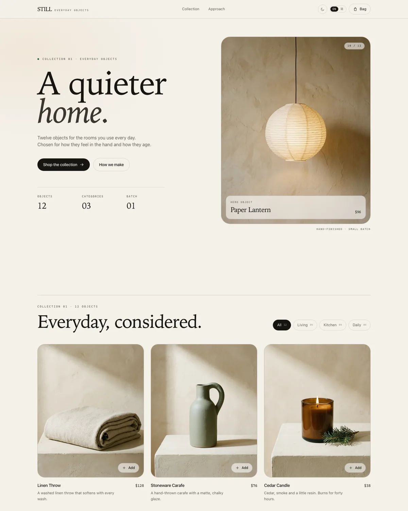

# STILL

A storefront built as a test bench for Apple's Liquid Glass effect over live HTML rendered into canvas. This is stage 01: the storefront foundation. The canvas host and the refraction shader are not built yet.

The store sells six home and daily objects. It ships in English and Simplified Chinese, with dark and light themes. It has category filters, a cart that survives reload, and a demo checkout. Product photography is generated for this storefront and stored as WebP under `public/products/`.



## Run it

```sh
pnpm install
pnpm dev
```

Open http://localhost:5173.

## Scripts

| Command | Does |
| --- | --- |
| `pnpm dev` | Start the Vite dev server. |
| `pnpm build` | Type-check and build to `dist/`. |
| `pnpm test` | Run the Vitest suite. |
| `pnpm lint` | Run ESLint with `@antfu/eslint-config`. |
| `pnpm typecheck` | Run `vue-tsc` only. |

## How it is put together

`src/domain/` holds the catalog, money helpers, the pure cart reducer, totals, and the localStorage boundary. Product names and descriptions are `LocalizedText`, so every object carries English and Simplified Chinese copy. The cart state stores product ids and quantities only. Prices are joined from the catalog when the UI reads the cart, so a price change cannot leave stale copies behind.

`src/i18n/messages.ts` is the typed message dictionary. `translate()` replaces named parameters. The locale follows the browser on first load, persists under `still.locale`, and updates `<html lang>`, the document title, and the meta description.

`src/styles/main.css` defines the palette as CSS variables on `html`. `useTheme()` writes `data-theme` on the same element, persists the choice under `still.theme`, and updates the browser theme color. The first paint reads the stored theme from a small inline script in `index.html`, so the page does not flash the wrong palette.

`src/composables/useCart.ts` wraps the reducer in a small Vue store and provides it through `CART_KEY`. Components call `useCart()`.

`src/components/CollectionSection.vue` is the collection stage. It uses plain flow layout and no measurement, so a canvas host can wrap it later. The rest of `src/components/` is the page shell, product cards, and cart drawer.

## Cart model

`CartState` is an ordered list of `{ productId, quantity }`. The reducer keeps one line per product, preserves first-add order, clamps quantity to 99, and removes a line when its quantity drops below one. Shipping is free from $150, otherwise it is a flat $12.

The cart persists under `still.cart.v1`. Reads validate every line: unknown ids, non-integer quantities, and zero quantities are dropped, and duplicate ids are merged. A failed read or write leaves the app working.

## Stack

Vite 8, Vue 3.5, TypeScript 6, UnoCSS, Vitest with jsdom, ESLint with `@antfu/eslint-config`, and pnpm. CI runs lint, typecheck, test, and build on every push and pull request.

## Not built yet

The next stage wraps the collection stage in `<canvas layoutsubtree>`, captures it with `drawElementImage()`, and draws a WebGL glass layer over the live texture. That path needs Chrome 157 or later, where HTML-in-Canvas is on by default.
