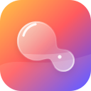
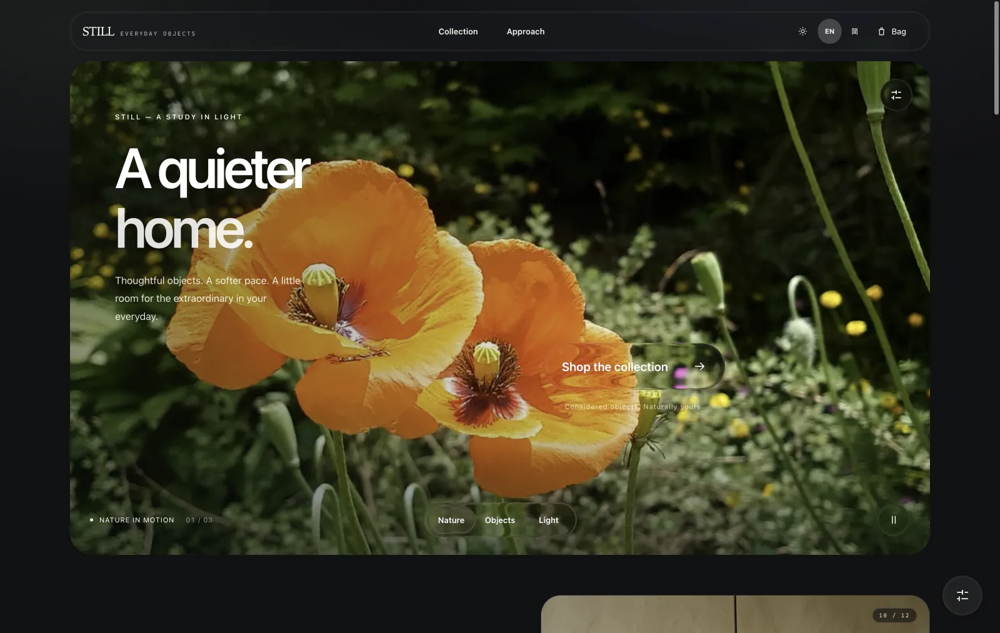
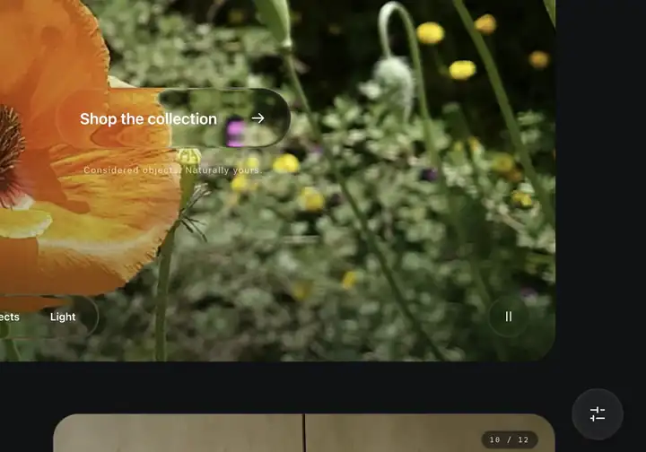
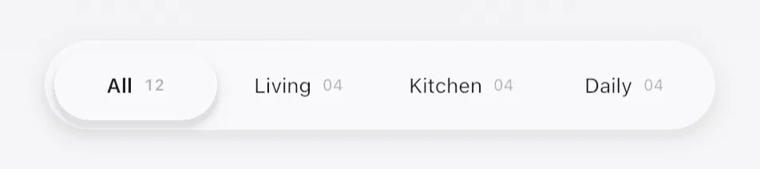
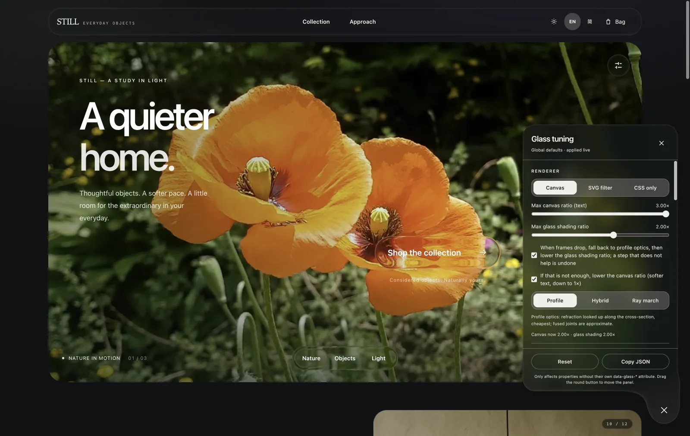
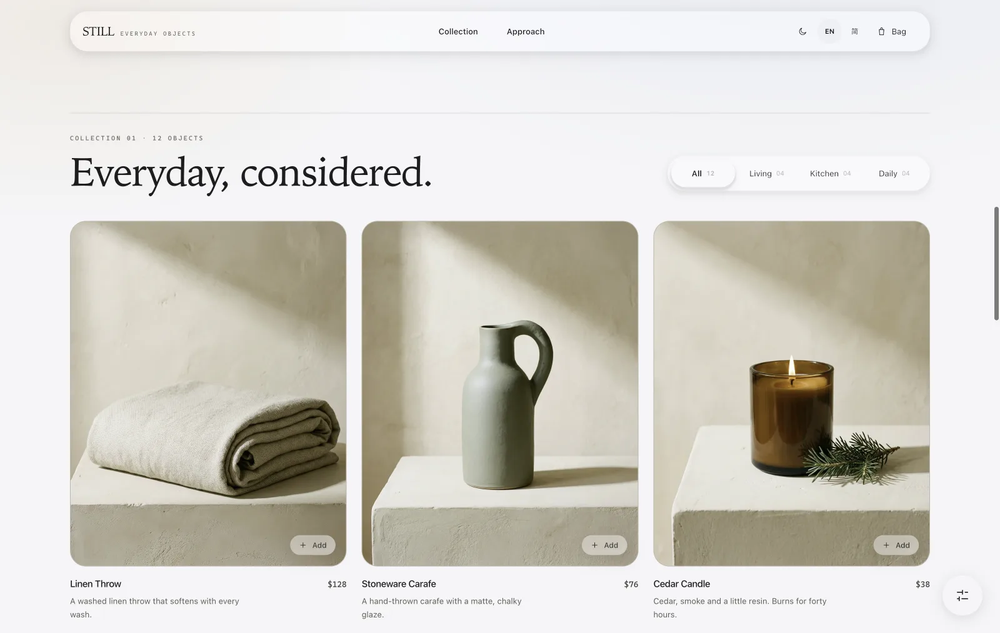

<p align="center">
  
</p>

<h1 align="center">liquid-in-canvas</h1>

<p align="center">
  iOS-style Liquid Glass for live HTML, rendered with <b>HTML-in-Canvas + WebGPU</b>.
</p>

<p align="center">
  <a href="https://liquid-in-canvas.netlify.app/"></a>
  <a href="https://github.com/YanAndFish/liquid-in-canvas/actions/workflows/ci.yml"></a>
  <a href="https://app.netlify.com/projects/liquid-in-canvas/deploys"></a>
  
  
</p>

<p align="center">
  <b>English</b> · <a href="README.zh-CN.md">简体中文</a>
</p>

<p align="center">
  <a href="https://liquid-in-canvas.netlify.app/"></a>
</p>

Add an attribute to an ordinary element and it becomes a piece of glass that refracts, magnifies and disperses whatever is behind it — video, images, text, other glass. The page stays real HTML: clickable, focusable and accessible. The browser uploads the page and the glass controls as textures, and the library composites them into one canvas with WebGPU.

## Features

- **Physically inspired optics**: refraction through a 3D glass body with a configurable bevel, convex lens magnification, chromatic dispersion, directional rim highlights and shadows.
- **Liquid behaviour**: glass on the same layer fuses like liquid when it gets close; the active item of a tab group flows to its new position; glass deforms slightly when pressed.
- **Correct layering**: page content can sit above or below glass, and stacked glass layers refract each other.
- **Fallbacks built in**: one set of `data-glass-*` attributes drives three renderers — WebGPU canvas, an SVG displacement filter (Chromium) and plain `backdrop-filter`.
- **Adaptive quality**: canvas resolution (text sharpness) and glass shading resolution are controlled separately; sustained frame drops lower the cheapest setting first and restore it when things are smooth again.
- **Small and framework-agnostic**: no runtime dependencies. The WebGPU renderer is loaded only after the capability check passes. Typed attributes for Vue templates and React JSX.

|                                                                   Same-layer fusion                                                                   |                                             Liquid morph                                              |
| :---------------------------------------------------------------------------------------------------------------------------------------------------: | :---------------------------------------------------------------------------------------------------: |
|  |  |
|                                         Drag a glass button: it trails a droplet and fuses with nearby glass.                                         |                      The active tab stretches, flows to the new tab and settles.                      |

## Quick start

```sh
pnpm add liquid-in-canvas
```

Mark the elements that should be glass:

```html
<div id="app">
  <div style="position: relative">
    <button data-liquid-glass data-glass-radius="999">Shop the collection</button>
  </div>
</div>
```

Mount the stage on the root element:

```ts
import { mountLiquidGlass } from 'liquid-in-canvas'

const glass = await mountLiquidGlass({
  root: document.querySelector('#app')!,
  canvasClass: 'stage',
})

console.log(glass.mode) // 'canvas', 'svg' or 'css'
```

In canvas mode the root is moved into a `<canvas content="drawable">`, so size the canvas yourself and scroll inside the root instead of `window`:

```css
.stage {
  position: fixed;
  inset: 0;
  width: 100dvw;
  height: 100dvh;
  display: block;
}
#app[drawable] {
  width: 100dvw;
  height: 100dvh;
  overflow: clip;
}
```

`mode` defaults to `'auto'`, which tries `canvas` → `svg` → `css` and falls back at runtime if the GPU faults. With a framework, mount your app in `beforeStart`.

The [library README](packages/liquid-in-canvas/README.md) documents render modes and `onFault`, every `data-glass-*` attribute, nested glass and liquid morph, global defaults (`setGlassDefaults()`), resolution and performance options, and the TypeScript entry points for Vue and React.

## Browser support

| Renderer | What you get                                                                                         | Where                                                                                                          |
| -------- | ---------------------------------------------------------------------------------------------------- | -------------------------------------------------------------------------------------------------------------- |
| `canvas` | Everything above                                                                                     | Browsers with HTML-in-Canvas, WebGPU and `GPUQueue.drawElementImageToTexture()` (developed against Chrome 157) |
| `svg`    | Blur, tint, edge refraction, dispersion and rim highlight. No fusion, occlusion or press deformation | Chromium-based browsers                                                                                        |
| `css`    | Blur, tint, rim highlight and shadow                                                                 | Any browser with `backdrop-filter`                                                                             |

## The demo: STILL

[STILL](https://liquid-in-canvas.netlify.app/) is a small bilingual storefront built on the library: video backgrounds behind glass navigation, product filters with liquid tabs, a cart drawer, light and dark themes, and reduced-motion / reduced-transparency support. No real orders are created.

The round button in the bottom-right corner opens a **glass tuner**. It switches renderers and resolution limits and edits the global defaults live (materials, bevel profile, fusion, liquid motion). **Copy JSON** produces an object you can pass straight to `setGlassDefaults()`. The tuner ships in the library as `liquid-in-canvas/tuner`, framework-agnostic, so your own pages can use it too.

|                                        Glass tuner                                         |                                                  Light theme                                                  |
| :----------------------------------------------------------------------------------------: | :-----------------------------------------------------------------------------------------------------------: |
|  |  |

## Development

Requires Node.js `>=20.19` and pnpm `12.9.1`.

```sh
pnpm install
pnpm dev        # demo at http://localhost:5173
```

```sh
pnpm lint && pnpm typecheck && pnpm test && pnpm build
```

```
packages/liquid-in-canvas   the renderer library
apps/demo                   the STILL demo (Vue 3), uses the library source directly
docs                        architecture, visual references and performance records
```

Release with `pnpm release`: [bumpp](https://github.com/antfu-collective/bumpp) bumps the root and library versions, commits, tags `v*` and pushes. The tag triggers `.github/workflows/release.yml`, which checks, builds and publishes to npm (prereleases go to the `next` dist-tag) and creates a GitHub Release. The workflow needs an `NPM_TOKEN` repository secret, or trusted publishing configured for it on npm. If you publish by hand, use `pnpm publish`, not `npm publish`: only pnpm swaps the source `exports` for the `dist` ones in `publishConfig`. See [ARCHITECTURE.md](docs/ARCHITECTURE.md) before changing the renderer.

## Known issues

- At high pixel ratios, the browser drawing the page into the canvas can exceed the frame budget on its own (about 1 ms per megapixel per frame on an M1, even for a blank page). By default, adaptive quality keeps the canvas resolution so text stays sharp, and the frame rate drops below 60. To trade text sharpness for frame rate, set `minPixelRatio`. See the performance records on [fill rate](docs/performance/2026-11-13-fill-rate/README.md) and [keeping text sharp](docs/performance/2026-11-16-text-floor/README.md); not yet measured on real devices.
- The SVG fallback only works in Chromium, and glass larger than 120,000 CSS px² gets blur only.
- The first scroll after a cold start can drop frames while the browser rasterizes for the first time.

## Scope and credits

This is a web approximation of Apple's Liquid Glass, not the native material. Fusion uses a smooth 3D signed distance field to approximate surface tension; content-aware adaptation and device-motion lighting are not implemented. The screenshots, observations, and implementation limits are documented in the [Apple Liquid Glass visual reference](docs/APPLE_LIQUID_GLASS_REFERENCE.md).

[liquid-glass-studio](https://github.com/iyinchao/liquid-glass-studio) was a research reference for refraction, dispersion, SDFs and multi-pass blur. The flower video comes from Pixabay / Pexels footage referenced by that project; product photos live in `apps/demo/public/products/`. Apple reference screenshots are used only in the research notes, never as demo assets.
