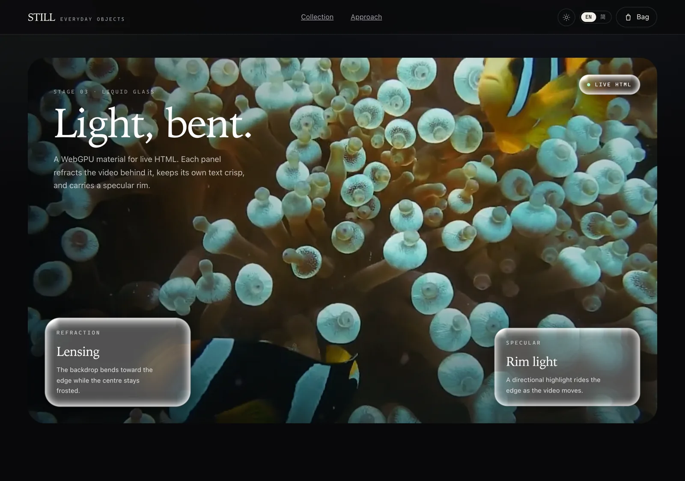
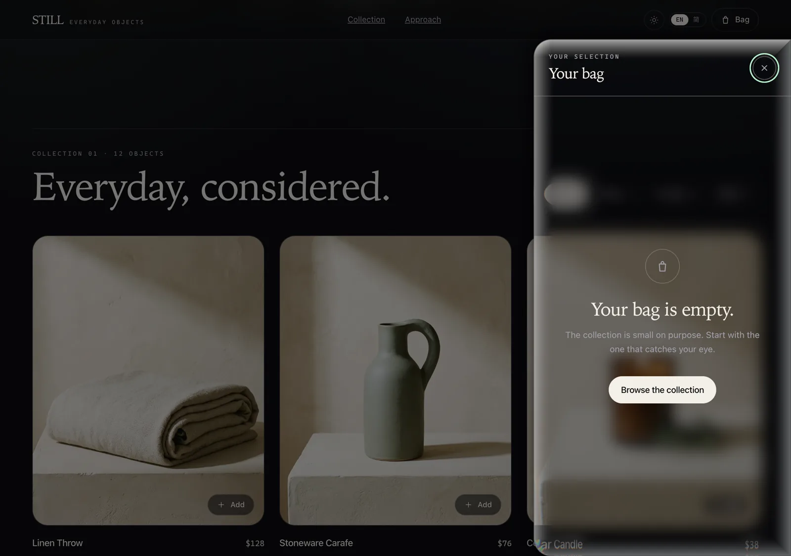
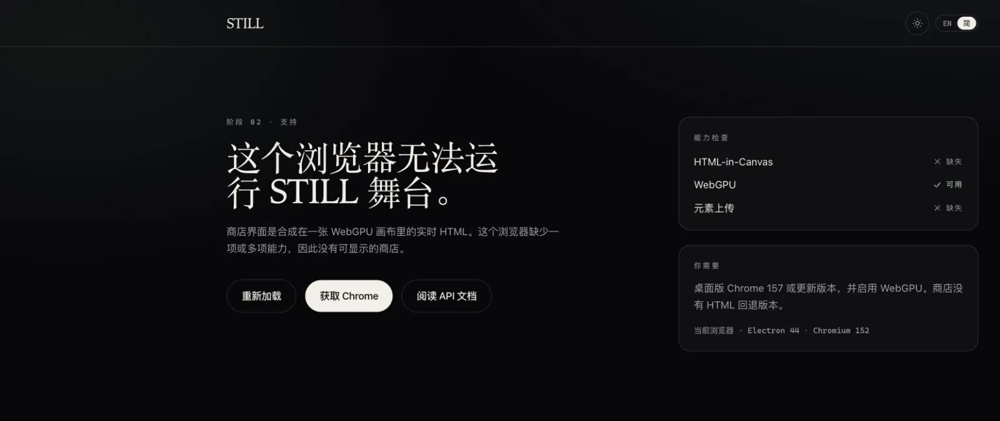

# STILL

A storefront built as a test bench for Apple's Liquid Glass effect over live HTML rendered into canvas. This is stage 03: the whole page is live HTML composited through a three.js WebGPU canvas, and the cart drawer plus the showreel panels are rendered with a WebGPU liquid-glass material.

The store sells twelve home and daily objects. It ships in English and Simplified Chinese, with dark and light themes. It has category filters, product detail pages, a cart that survives reload, and a demo checkout. Product photography was generated for this storefront and stored as WebP under `public/products/`.






## Requirements

Desktop Chrome 157 or newer with WebGPU. Unsupported browsers see a support notice that explains what is missing. There is no fallback storefront.



Implementation notes and the problems found along the way live in [HTML_IN_CANVAS_NOTES.md](HTML_IN_CANVAS_NOTES.md) and [LIQUID_GLASS_NOTES.md](LIQUID_GLASS_NOTES.md).

## Run it

```sh
pnpm install
pnpm dev
```

Open http://localhost:5173.

## Scripts

| Command | Does |
| --- | --- |
| `pnpm dev` | Start the Vite dev server. |
| `pnpm build` | Type-check and build to `dist/`. |
| `pnpm test` | Run the Vitest suite. |
| `pnpm lint` | Run ESLint with `@antfu/eslint-config`. |
| `pnpm typecheck` | Run `vue-tsc` only. |

## Routes

| Route | Shows |
| --- | --- |
| `/` | Hero, liquid-glass showreel, collection filters, product grid, and the approach section. |
| `/product/:slug` | Product detail with copy, specs, add to bag, and three related objects. |
| Any other path | A not found page. |

## Liquid glass

The drawer and the showreel cards are ordinary DOM elements with attributes:

```html
<aside
  data-liquid-glass
  data-glass-anchor="#cart-shell"
  data-glass-radius="28 0 0 28"
  data-glass-blur="18"
  data-glass-refraction="26"
  data-glass-dispersion="0.36"
  data-glass-tint="#0b0d12"
  data-glass-tint-alpha="0.1"
  data-glass-specular="0.62"
  data-glass-shadow="0.55"
  data-glass-shadow-size="38"
>
  ...
</aside>
```

| Attribute | Default | Range | Meaning |
| --- | --- | --- | --- |
| `data-liquid-glass` | absent | attribute | Marks the surface. The stage adds `drawable`. |
| `data-glass-anchor` | offset parent | CSS selector | Non-drawable ancestor used for measurement. |
| `data-glass-radius` | `28` | 0 to 2000 | One to four corner radii, CSS order. |
| `data-glass-blur` | 18 regular, 8 clear | 0 to 80 | Blur strength and soft/heavy layer mix. |
| `data-glass-refraction` | 24 regular, 20 clear | 0 to 80 | Edge lens offset in CSS pixels. |
| `data-glass-dispersion` | 0.3 regular, 0.4 clear | 0 to 1 | Per-channel offset difference. |
| `data-glass-tint` | `#ffffff` dark, `#f7f2e8` light | `#rgb` or `#rrggbb` | Colour mixed into the glass. |
| `data-glass-tint-alpha` | 0.04 dark, 0.12 light | 0 to 1 | Tint strength. |
| `data-glass-specular` | 0.7 regular, 0.9 clear | 0 to 2 | Rim and glare strength. |
| `data-glass-shadow` | 0.32 regular, 0.26 clear | 0 to 1 | Shadow opacity. |
| `data-glass-shadow-size` | 32 regular, 28 clear | 0 to 100 | Shadow falloff and mesh padding. |
| `data-glass-variant` | `regular` | `regular` or `clear` | Preset before explicit attributes override it. |

Each surface is a nested `drawable` element. The root snapshot leaves a hole where it sits, and the surface is captured separately with a transparent background. A TSL mesh samples the page snapshot behind the panel, applies refraction, dispersion, a two-level separable Gaussian blur, tint, specular and shadow, then composites the panel's own crisp content texture. The drawer slides with a `right` transition because a CSS transform makes the drawable snapshot empty in Chrome 157.

The showreel video is a trimmed, compressed copy of the flower sample used by [liquid-glass-studio](https://github.com/iyinchao/liquid-glass-studio). Its original source is credited there to Pixabay.

## Structure

`src/pages/` holds the route views: `HomeView`, `ProductView`, and `NotFoundView`. `UnsupportedView` is the standalone support page, mounted outside the router when the browser lacks the canvas APIs.

`src/components/` is grouped by feature. `layout/` holds the header and footer. `home/` holds the hero, glass showreel, collection, filter, and approach. `product/` holds the card and grid. `cart/` holds the drawer and line row. `ui/` holds shared icons.

`src/router/` exports the route table and the browser router. `routes.ts` is separate so tests can build a memory router from the same table.

`src/stage/` owns the canvas host. `support.ts` detects HTML-in-Canvas, WebGPU, and `drawElementImageToTexture`. `CanvasStage.ts` creates the three.js WebGPU renderer, uploads the drawable root on every `paint` event, forwards changed elements and the video clock, and renders the page mesh. `liquid-glass/` holds the attribute parser, the TSL material and the surface layer. `scroll.ts` resolves the inner scroller. `src/types/html-in-canvas.d.ts` declares the browser APIs that TypeScript does not ship yet.

`src/stores/cart.ts` is the cart store. It exposes readonly state, derived lines and totals, and the actions `add`, `increment`, `decrement`, `remove`, and `clear`. `createCartStore` is provided through `CART_KEY`, so components call `useCart()` and no state library is needed.

`src/domain/` holds the catalog, money helpers, cart selectors, and the localStorage boundary. Product names, descriptions, details, and specs are `LocalizedText`, so every object carries English and Simplified Chinese copy. The cart state stores product ids and quantities only. Prices are joined from the catalog when the UI reads the cart, so a price change cannot leave stale copies behind.

`src/i18n/messages.ts` is the typed message dictionary. `translate()` replaces named parameters. The locale follows the browser on first load, persists under `still.locale`, and updates `<html lang>`, the document title, and the meta description.

`src/styles/main.css` defines the palette as CSS variables on `html`. `useTheme()` writes `data-theme` on the same element, persists the choice under `still.theme`, and updates the browser theme color. The first paint reads the stored theme from a small inline script in `index.html`, so the page does not flash the wrong palette.

`tests/` holds every test, split into `domain/`, `stores/`, `i18n/`, `stage/`, and `app/`. Colocated test files are gone.

## Cart model

`CartState` is an ordered list of `{ productId, quantity }`. The store keeps one line per product, preserves first-add order, clamps quantity to 99, and removes a line when its quantity drops below one. Shipping is free from $150, otherwise it is a flat $12.

The cart persists under `still.cart.v1`. Reads validate every line: unknown ids, non-integer quantities, and zero quantities are dropped, and duplicate ids are merged. A failed read or write leaves the app working.

## Stack

Vite 8, Vue 3.5, Vue Router 5, TypeScript 6, UnoCSS, three.js r187 with the WebGPU renderer, Vitest with jsdom, ESLint with `@antfu/eslint-config`, and pnpm. CI runs lint, typecheck, test, and build on every push and pull request.

## Stage 03

The drawable root is `#app`, with explicit `100dvw` and `100dvh` sizes because canvas descendants are laid out without document flow. Inside it, `#stage-scroll` is the only scroller, so routing and the cart lock move the inner element instead of the window.

Every canvas `paint` event uploads the root with `drawElementImageToTexture()` into an `rgba8unorm-srgb` texture, then renders a full-screen mesh with `MeshBasicMaterial`. The stage wraps a `GPUTexture` in three's `ExternalTexture` instead of using `HTMLTexture`, because three's WebGPU path for `HTMLTexture` still calls the removed `copyElementImageToTexture` API.

Liquid-glass surfaces are excluded from the root snapshot by their own `drawable` attribute. Each surface is uploaded into a second texture, placed over the page mesh with a padded plane, and rendered with a TSL `MeshBasicNodeMaterial` that performs the SDF, finite-difference refraction, two-level separable Gaussian blur, tint, specular and shadow work. The drawer starts below the 64px header, uses a theme-specific tint, and slides with a `right` transition. The showreel is a sticky video frame with three glass surfaces and a small video clock that repaints the canvas while the clip plays.

See [LIQUID_GLASS_NOTES.md](LIQUID_GLASS_NOTES.md) for the shader math, the Chrome snapshot pitfalls and the measurements.
