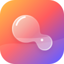
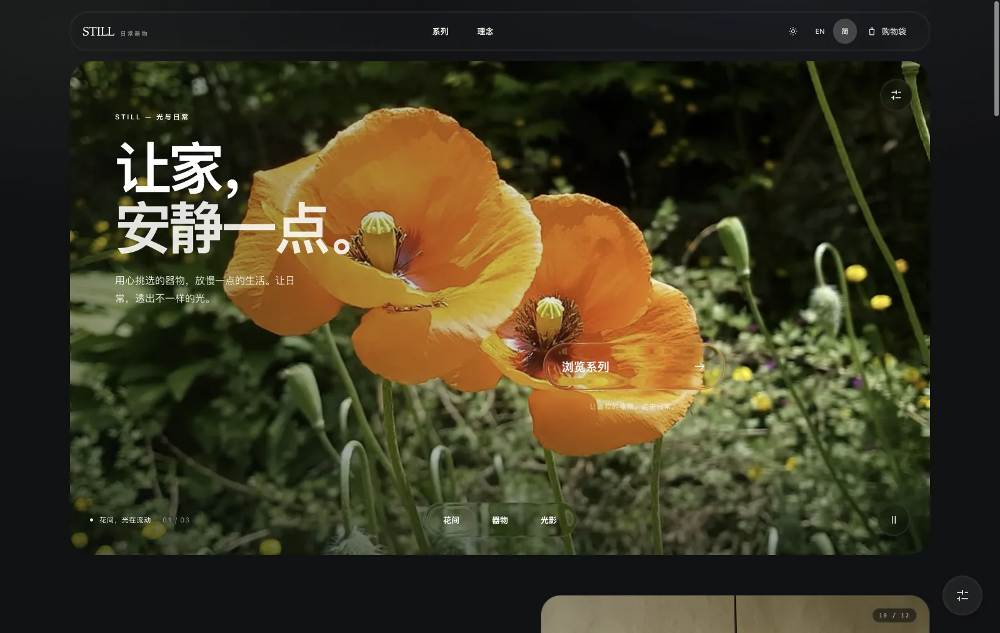
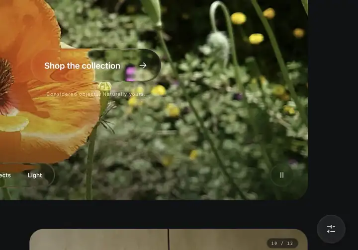
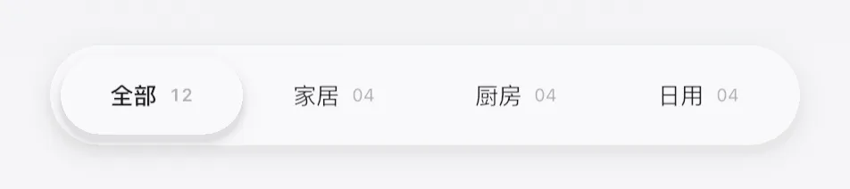
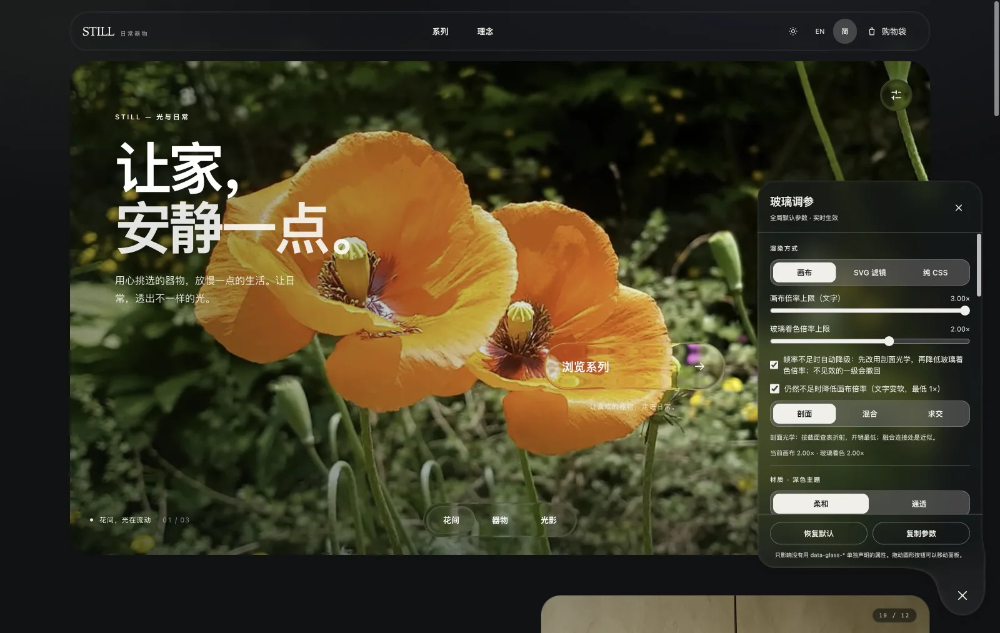
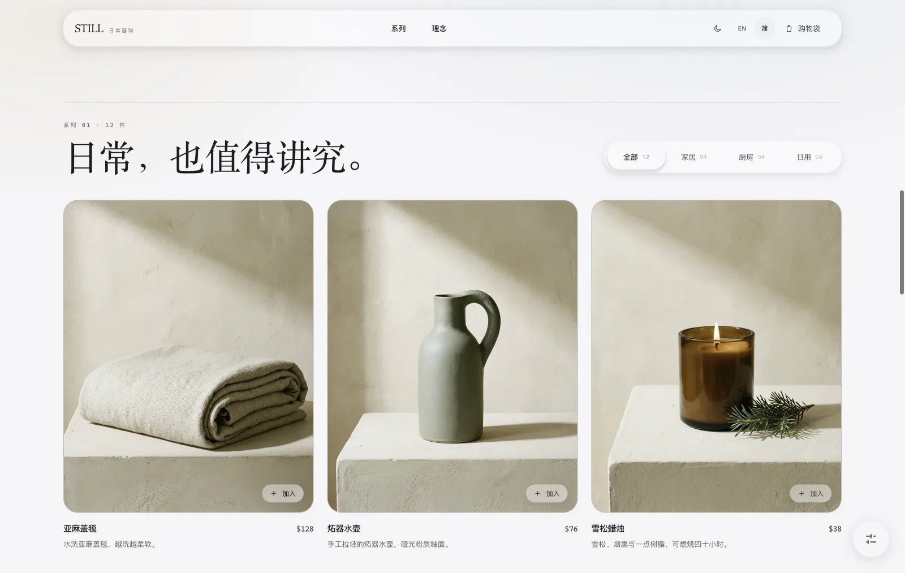

<p align="center">
  
</p>

<h1 align="center">liquid-in-canvas</h1>

<p align="center">
  用 <b>HTML-in-Canvas + WebGPU</b> 给实时 HTML 加上 iOS 风格的液态玻璃。
</p>

<p align="center">
  <a href="https://liquid-in-canvas.netlify.app/"></a>
  <a href="https://github.com/YanAndFish/liquid-in-canvas/actions/workflows/ci.yml"></a>
  <a href="https://app.netlify.com/projects/liquid-in-canvas/deploys"></a>
  
  
</p>

<p align="center">
  <a href="README.md">English</a> · <b>简体中文</b>
</p>

<p align="center">
  <a href="https://liquid-in-canvas.netlify.app/"></a>
</p>

在普通元素上加一个属性，它就成为一块玻璃，折射、放大并色散背后的内容：视频、图片、文字，或者另一块玻璃。页面仍然是真实的 HTML，可以点击、聚焦，也能被辅助技术读取。浏览器把页面与玻璃控件分别上传为纹理，库用 WebGPU 把它们合成到同一张画布。

## 特性

- **光学效果**：光线穿过带倒角的三维玻璃体发生折射，倒角可调；凸透镜放大、色散、按光照方向分布的轮廓高光和阴影。
- **液体行为**：同层玻璃靠近时像液体一样融合；标签组的激活项流动到新位置；按住玻璃有轻微形变。
- **层次正确**：页面内容可以位于玻璃之上或之下，叠放的玻璃层之间相互折射。
- **内置回退**：同一套 `data-glass-*` 属性驱动三种实现：WebGPU 画布、SVG 位移滤镜（Chromium）和纯 `backdrop-filter`。
- **自适应画质**：画布分辨率（决定文字清晰度）和玻璃着色分辨率分开控制；持续掉帧时先降低损失最小的一项，流畅后再升回。
- **轻量、与框架无关**：没有运行时依赖。WebGPU 渲染器在能力检查通过后才加载。为 Vue 模板与 React JSX 提供属性类型。

|                                                   同层融合                                                    |                                       液体迁移                                        |
| :-----------------------------------------------------------------------------------------------------------: | :-----------------------------------------------------------------------------------: |
|  |  |
|                               拖动玻璃按钮，后面拖出液滴，靠近其他玻璃时融合。                                |                        激活项被拉长、流到新标签，再收拢停下。                         |

## 快速开始

```sh
pnpm add liquid-in-canvas
```

给要成为玻璃的元素加上属性：

```html
<div id="app">
  <div style="position: relative">
    <button data-liquid-glass data-glass-radius="999">浏览系列</button>
  </div>
</div>
```

在根元素上挂载：

```ts
import { mountLiquidGlass } from 'liquid-in-canvas'

const glass = await mountLiquidGlass({
  root: document.querySelector('#app')!,
  canvasClass: 'stage',
})

console.log(glass.mode) // 'canvas'、'svg' 或 'css'
```

画布模式下，根元素会被移入一张 `<canvas content="drawable">`。画布的尺寸由你的样式决定，页面滚动要发生在根元素内部，而不是 `window`：

```css
.stage {
  position: fixed;
  inset: 0;
  width: 100dvw;
  height: 100dvh;
  display: block;
}
#app[drawable] {
  width: 100dvw;
  height: 100dvh;
  overflow: clip;
}
```

`mode` 缺省为 `'auto'`：按 `canvas` → `svg` → `css` 的顺序尝试，GPU 运行中出错时也会回退。使用框架时，在 `beforeStart` 里挂载应用。

其余内容见[渲染库的 README](packages/liquid-in-canvas/README.zh-CN.md)：渲染方式与 `onFault`、全部 `data-glass-*` 属性、嵌套玻璃与液体迁移、全局默认参数（`setGlassDefaults()`）、分辨率与性能选项，以及 Vue 和 React 的类型入口。

## 浏览器支持

| 实现     | 效果                                                           | 浏览器                                                                                                |
| -------- | -------------------------------------------------------------- | ----------------------------------------------------------------------------------------------------- |
| `canvas` | 上面列出的全部效果                                             | 支持 HTML-in-Canvas、WebGPU 和 `GPUQueue.drawElementImageToTexture()` 的浏览器（开发使用 Chrome 157） |
| `svg`    | 模糊、染色、边缘折射、色散和轮廓高光。没有融合、遮挡和按压形变 | Chromium 内核                                                                                         |
| `css`    | 模糊、染色、轮廓高光和阴影                                     | 支持 `backdrop-filter` 的浏览器                                                                       |

## 演示：STILL

[STILL](https://liquid-in-canvas.netlify.app/) 是用这个库搭建的中英双语小商店：视频背景上的玻璃导航、带液体标签的商品筛选、购物袋、深浅主题，并跟随系统的减少动态效果和减少透明度设置。不会创建真实订单。

右下角的圆形按钮打开**调参面板**，可以切换渲染方式和分辨率上限，实时修改全局默认参数（材质、倒角截面、融合、液体流动）。**复制参数**得到的 JSON 可以直接传给 `setGlassDefaults()`。这个面板由库的 `liquid-in-canvas/tuner` 提供，不依赖前端框架，你的页面也可以直接使用。

|                                调参面板                                |                                      浅色主题                                       |
| :--------------------------------------------------------------------: | :---------------------------------------------------------------------------------: |
|  |  |

## 开发

需要 Node.js `>=20.19` 和 pnpm `12.9.1`。

```sh
pnpm install
pnpm dev        # 演示商店，默认 http://localhost:5173
```

```sh
pnpm lint && pnpm typecheck && pnpm test && pnpm build
```

```
packages/liquid-in-canvas   渲染库
apps/demo                   演示商店 STILL（Vue 3），直接引用库的源码
docs                        架构、视觉依据与性能记录
```

发布用 `pnpm release`：[bumpp](https://github.com/antfu-collective/bumpp) 修改根与库的版本号，提交、打 `v*` 标签并推送，标签触发 `.github/workflows/release.yml` 检查、构建并发布到 npm（预发布版本使用 `next` 标签），再生成 GitHub Release。工作流需要仓库密钥 `NPM_TOKEN`，或在 npm 上为这个工作流配置 trusted publishing。手动发布也必须用 `pnpm publish`，不要用 `npm publish`：只有 pnpm 会把指向源码的 `exports` 换成 `publishConfig` 里指向 `dist` 的版本。修改渲染器前请先读 [ARCHITECTURE.md](docs/ARCHITECTURE.md)。

## 已知问题

- 高分辨率下整页快照本身就可能超出帧预算。自适应降级最后才降低画布分辨率，此时文字变软。见性能记录：[填充率](docs/performance/2026-11-13-fill-rate/README.md)、[画布倍率的自适应降级](docs/performance/2026-11-15-adaptive-canvas/README.md)；没有在真机上测量过。
- SVG 滤镜回退只在 Chromium 内核上生效，面积超过 12 万 CSS 像素的玻璃只有模糊。
- 冷启动后第一次滚动可能因浏览器首次栅格化而掉帧。

## 范围与来源

这是对 Apple Liquid Glass 视觉行为的 Web 近似实现，不是原生材质。同层融合用三维平滑距离场近似表面张力；背景语义适配和设备姿态光照尚未实现。视觉依据与限制见 [Apple Liquid Glass 视觉依据](docs/APPLE_LIQUID_GLASS_REFERENCE.zh-CN.md)。

[liquid-glass-studio](https://github.com/iyinchao/liquid-glass-studio) 提供了折射、色散、SDF 和多遍模糊的研究参考。花朵视频使用该项目引用的 Pixabay / Pexels 素材，商品图保存在 `apps/demo/public/products/`。Apple 参考截图只在研究文档中引用，不作为演示素材。
