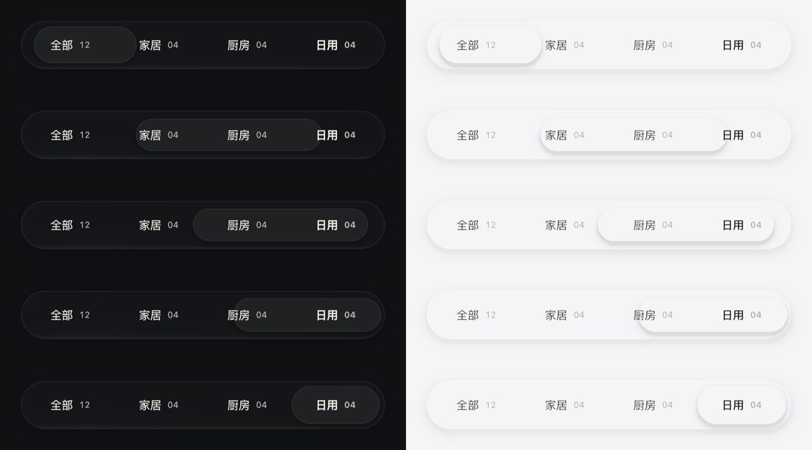
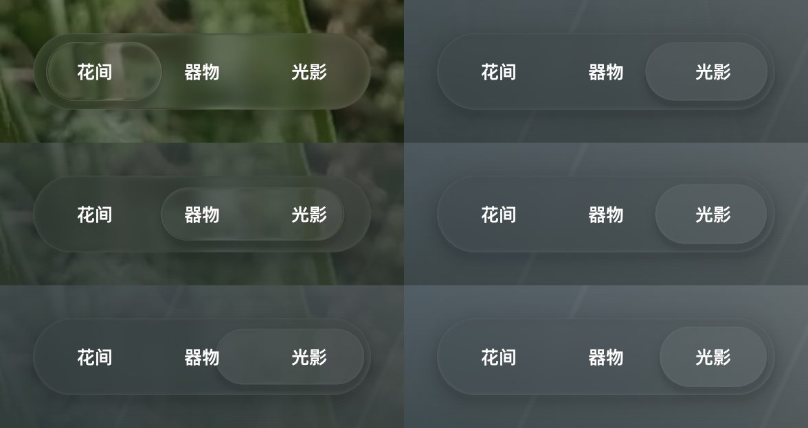

# 直接使用 WebGPU 的画布渲染器

2026-11-13，Chrome 157.0.8103.39，Apple Metal 3。基线为 `91726f0`（three.js 0.187.0）的生产构建。高倍率和手机视口用 CDP 的 `Emulation.setDeviceMetricsOverride` 模拟，GPU 是同一台桌面机器的，**没有在真机上测量**。

## 结论

画布渲染器从 `three/webgpu` + `three/tsl` 改为直接使用 WebGPU，并按液态玻璃的绘制方式重新组织。

| 项目 | three.js | 直接使用 WebGPU |
| --- | --- | --- |
| 演示生产构建中的画布渲染器分块 | 854 kB，gzip 232 kB | 57.4 kB，gzip 19.6 kB |
| 桌面 1563 × 1013 @2，每帧 GPU 时间 | 4.74–5.08 ms | 4.66–4.83 ms |
| 手机 412 × 915 @3，每帧 GPU 时间 | 5.78–5.89 ms | 3.42–3.50 ms |
| 以上两种视口的绘制间隔 | 16.7 ms | 16.7 ms |
| 桌面 @3、画布与玻璃都是 3 倍（GPU 饱和），绘制间隔 | 21.6–21.8 ms | 20.6–21.5 ms |
| 每帧 CPU 时间（桌面 @2 / 手机） | 2.70–2.74 / 1.39–1.68 ms | 2.37–2.42 / 1.20–1.30 ms |

新版的数字已经包含新增的凸透镜（默认开启）。两种视口下 GPU 时间与绘制间隔都没有变差；手机视口下降最多，玻璃以 2 倍着色、再分块放大合成到 3 倍画布的路径在 three.js 里要多走一层场景与材质。

同时加入了两项效果：玻璃的凸透镜放大，以及标签组激活项的液体迁移，见[架构](../../ARCHITECTURE.md)。

## 新结构

所有绘制都是“一个矩形 + 一段 uniform”，`gpu.ts` 围绕这一点组织：

- 顶点着色器按 uniform 开头的矩形生成四个顶点，没有顶点缓冲与场景图。
- 一帧所有绘制项的 uniform 写进同一块内存，提交前一次 `writeBuffer`，绘制时用动态偏移切换。
- 一帧只有一个命令缓冲：背景合成、模糊、低分辨率体积、画布遍。
- 管线按键缓存：体积着色器按成员数量，内容着色器按遮挡数量。滚动中成员变化只取用已有管线（`tests/stage/volume-groups.test.ts` 用记录调用的假设备检查）。启动时在后台编译常见数量，第一次出现融合时不需要等待编译。
- 画布配置为 8 位格式，以 sRGB 视图写入；混合在线性空间进行。
- 体积着色器原先为了取光学参数和染色各做一次平滑合并，加上透镜偏移就要三次，每次都对所有成员求距离场。现在三者共用一次合并，算术顺序不变，结果逐位相同。

`blur.ts`、`ContentBackdrop`、`VolumeGroups`、内容遮挡的计算方式与原来一致，只是换成了直接的绘制项。

## 画面一致性

与基线逐像素比较，新版用 `?lens=0` 关闭透镜（`tools/shots.mjs`、`tools/diff.py`）。截图本身可复现：基线截两次，19 张里只有一张有 12 个像素相差 1 级。

纯库的画面检查页：

| 画面 | 最大差值（8 位） | 超过 1 级的像素 |
| --- | --- | --- |
| `tests/visual/liquid-glass.html` 默认 | 1 | 0 |
| 同上，两块玻璃重叠 | 3 | 1 |
| 同上，圆形移到上层 | 1 | 0 |
| 同上，清晰背景、厚度 48、色散 1 | 17 | 21 |
| `tests/visual/glass-content.html` | 0 | 0 |

超过 1 级的像素都在厚玻璃上下边缘的全内反射与掠射彩边里（见 `lens-compare.jpg` 左图的上下边缘）。这里出射光线接近水平，求交步进是病态的，编译器对浮点运算顺序的细微差别就会让个别像素换一条光路。three.js 把同一段 WGSL 包在 TSL 生成的代码里，与手写的着色器无法逐指令一致。其余区域逐像素差值不超过 1。

演示商店在桌面 @2 的 0 / 300 / 600 / 900 / 1100 / 1500 / 1900 / 2300 滚动位置、展开调参面板，以及手机 @3（玻璃 3 倍与 2 倍两种）的截图里，超过 1 级的像素全部落在三处：

- 首页场景切换与商品分类：激活项改成了嵌套玻璃，这是有意的改动。
- 调参面板：新增“透镜放大”一行，面板滚动条变短。
- 顶栏与手机首屏各有 2–7 个单像素，与上面的病态像素同类。

`tools/diff.py` 的完整输出在 `pixel-diff.txt`（与最终的演示比较，所以含上面三处改动）。

## GPU 时间戳

新版不能用“逐遍时间相加”比较。同一命令缓冲里相互依赖的遍会重叠：Apple GPU 在上一遍的片元还在执行时就开始下一遍的顶点阶段，时间戳从那时开始计时，等待被算进了下一遍。桌面 @2 下逐遍相加是 12.7 ms，其中“模糊”一类 8.7–10 ms，而整帧跨度（第一遍开始到最后一遍结束）只有 4.2–4.8 ms。

three.js 每次 `render()` 单独提交，逐遍相加与整帧接近，基线仍用逐遍相加。两者的提交方式不同，GPU 时间只能说明量级；GPU 饱和时的绘制间隔不受影响，是更可靠的比较。测量页因此改为：

- `gpu`：整帧跨度。
- `gpuPassSum`：逐遍相加，只用于和旧记录对照。
- `gpuPassTimes`、`gpuPassInfo`：逐遍明细，`fill-rate/tools/gpu.mjs` 的 `canvas` / `blur` / `backdrop` 分类仍按目标尺寸划分，同样受重叠影响。

## 液体迁移与透镜






截图间隔约 80 ms，由 `tools/morph.mjs` 连续截取。迁移约 0.6 秒，期间按动画帧请求重绘，静止后停止。

## 尚未解决

- GPU 饱和时（桌面 @3、玻璃 3 倍）新版两轮里各有一轮 p95 为 33.8–33.9 ms，基线为 29.3–30.1 ms，均值则低于基线。原因没有定位。
- 模糊仍对整个视口卷积。只卷积玻璃附近的区域可以省下大部分模糊开销，但折射光线最远会取样到 800 CSS 像素外，裁剪区域外的旧内容会出现在玻璃里，需要先限定取样范围。
- 嵌套玻璃折射的是页面背景，看不到外层玻璃的磨砂。

## 复测

隔离的 Chrome 与构建步骤同[上一份记录](../2026-11-13-fill-rate/README.md#复测)。`apps/demo/tests/perf/vite.config.ts` 现在也构建两个画面检查页，供截图比对使用。

```sh
node docs/performance/2026-11-13-fill-rate/tools/gpu.mjs "http://127.0.0.1:4183/?gpu&adaptive=0" 2
DPR=3 W=412 H=915 node docs/performance/2026-11-13-fill-rate/tools/gpu.mjs "http://127.0.0.1:4183/?gpu" 2
DPR=3 node docs/performance/2026-11-13-fill-rate/tools/gpu.mjs "http://127.0.0.1:4183/?maxPixelRatio=3&maxGlassPixelRatio=3&adaptive=0" 2
```

画面比对（两个构建分别在 4183 与 4184）：

```sh
cd docs/performance/2026-11-13-webgpu/tools
node shots.mjs http://127.0.0.1:4183 /tmp/shots/base
QUERY='lens=0' node shots.mjs http://127.0.0.1:4184 /tmp/shots/new
python3 diff.py /tmp/shots/base /tmp/shots/new
```

隔离的 Chrome 需要加上 `--disable-backgrounding-occluded-windows --disable-renderer-backgrounding`，否则窗口被遮住时页面不出帧，截图会卡住。原始数据见 `final-runs.txt`（每组两轮，每轮两次测量）。
