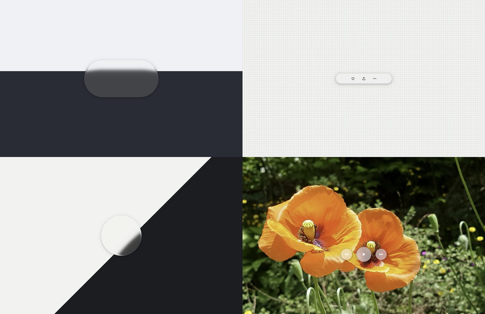

# 与官方液态玻璃画面的对照基线

2026-11-14，Chrome 157.0.8103.39，Apple Metal 3。基线为 `046f703` 的生产构建（`git archive` 导出，只加入本次新增的对照页），桌面视口 1563 × 1013 @2，`?adaptive=0` 固定倍率。本记录**只建立对照与测量工具**，没有修改渲染库；后续调整剖面（`profile.ts`、`defaults.ts` 的倒角宽度、曲线指数、厚度限制）以这里的数字为起点。

## 结论

参考画面的观察（见计划）：折射集中在边缘、中心平坦、采样朝内偏移，弯折带约占短边 15–25%。当前默认参数在两色胶囊上的测量结果：

| 条件（clear 材质） | 中心区域的位移 | 边缘弯折带 |
| --- | --- | --- |
| 默认（模糊 8、透镜 0.22） | 短边的 5.2%（24.8 px） | 被模糊掩盖，只能测到 d ≥ 短边 6.8% |
| `blur=0` | 短边的 5.8%（28.1 px） | 由透镜位移向边缘递减，d = 短边 4% 处约 3.9% |
| `blur=0&lens=0` | **0**（中心完全平坦） | d = 短边 3.4% 处 1.5%，**到短边 5.5% 已降到 0** |

- 关闭透镜后剖面的形状与参考一致（中心平坦、只有边缘折射、采样朝内），但**弯折带只有短边的约 4–5.5%**，参考是 15–25%，宽了 3–5 倍。下一步调参的主要方向是加宽倒角（`bevelWidth`），并相应检查曲线指数与厚度上限。
- 默认参数下中心区域整体位移 5% 以上，来自透镜放大，不是边缘折射。参考画面的中心是平坦的，透镜的默认强度需要和加宽后的倒角一起重新取值。
- 距轮廓不到短边约 3% 的区域在两色胶囊上测不到：那里朝内取样的距离超过了分界线到轮廓的距离，整段都取到暗色，分界线的像被推出可见范围。这是剖面陡峭的表现，不是工具的缺陷；要看更靠边的部分，把分界线放得离中心更近（`split` 取 −0.1 左右）再测一组。

单位约定：`d` 是观察点到玻璃轮廓的距离，`shift` 是采样点沿内法线相对观察点的位移，正值表示朝玻璃内部取样。胶囊短边在截图里是 480 像素（240 CSS 像素 × 2）。

## 对照页

`apps/demo/tests/visual/reference.html`（脚本 `reference.ts`），直接使用 `liquid-in-canvas/canvas` 的 `CanvasStage`。开发服务器上打开 `/tests/visual/reference.html`；`tests/perf/vite.config.ts` 也构建这一页。

| 场景 `scene=` | 几何 | 默认材质 |
| --- | --- | --- |
| `capsule` | 上浅下深的水平分界线，上面一枚 2:1 胶囊。分界线默认在胶囊中心上方 0.2 个短边 | clear |
| `toolbar` | 12 px 细网格上一条 360 × 64 的工具条，三个图标 | regular |
| `disc` | 45° 明暗分界线，上面一块直径 260 的圆形玻璃，分界线偏离圆心 0.2 个直径 | clear |
| `buttons` | 演示视频的封面照片上三颗圆形按钮（72 / 96 / 72），关闭融合 | regular |



参数面板（`H` 键隐藏）覆盖模糊、厚度 `refraction`、倒角宽／高、曲线指数、透镜、色散、底面高度 `elevation` 与融合距离，以及分界线偏移 `split`。所有参数也可以写在地址栏里（`?scene=capsule&blur=0&lens=0`），面板的改动同步到地址栏，便于把同一组条件交给截图脚本。`panel=0` 隐藏面板，`adaptive`、`maxPixelRatio`、`maxGlassPixelRatio` 与测量页相同。

当前场景的玻璃轮廓（CSS 像素）与分界线写在 `window.reference`，面板底部也显示，供测量脚本使用。背景全部由 CSS 绘制或使用 `public/media` 里已有的图片，没有使用 Apple 的素材。

## 剖面测量

`tools/profile_fit.py`，只依赖标准库与 Pillow（`python3 -m pip install --user Pillow`）。

做法：玻璃内每一列像素（竖直扫描线）里，找出线性亮度穿过两侧亮度中点的位置 `y_obs`；从玻璃外的背景得到同一列上分界线的真实位置 `y_true`。观察点 `p` 看到的是 `p − shift·n`（`n` 为轮廓外法线），它落在分界线上，所以

```
shift = (y_obs − y_true) / (n_y − k·n_x)      k 为分界线斜率，水平分界线时即 (y_obs − y_true) / n_y
```

胶囊两端的圆弧让 `d` 从 0 变化到分界线到轮廓的距离，一张截图就能得到一段曲线。法线几乎平行于分界线的列换算误差大，留空；只含半个过渡的端部短列按对比度剔除（`--contrast-ratio`）。

输出逐列样本 CSV（`--out`）与按 `d` 分组的中位数曲线（`--curve`），并拟合 `shift(d) = A·max(0, 1 − d/W)^p + C`，报告边缘位移 `A + C`、弯折带（位移降到 10% 的距离）与它们占短边的比例。

```sh
cd docs/performance/2026-11-14-visual/tools
python3 -I profile_fit.py selftest                                   # 合成图自检
python3 -I profile_fit.py measure shot.png --page shot.json --curve curve.csv --out samples.csv
python3 -I profile_fit.py measure apple.png --rect 120,300,400,200 --curve apple.csv   # 参考图：手工量轮廓，分界线自动检测
```

- `--page` 读取 `reference-shot.mjs` 写下的 JSON（轮廓、圆角、分界线、倍率）。
- 参考图没有 JSON：`--rect` 给图像像素的轮廓（或 CSS 像素配合 `--scale`），`--radius` 缺省为短边一半；分界线缺省从玻璃左右两侧的背景列自动检测，玻璃有阴影时用 `--gap` 调整跳过的距离，或用 `--boundary y` / `--boundary x,y,角度` 直接给出。
- 分界线不能接近竖直（超过 60° 时报错）。
- 模糊会把分界线拉成宽过渡，靠边的列装不下完整的过渡而被剔除。比较剖面时用 `blur=0`；参考图本身有模糊时，只比较 `d` 较大的部分。

### 自检

`selftest` 生成两张合成图（两色背景 + 已知剖面 `14·(1 − d/40)^2.5` 的位移场，加 8% 白色染色和 1.5 px 的边缘高光，分界线带 3 px 线性过渡），分别是水平分界线与 8° 斜线：

| 用例 | 曲线点 | 最大误差 | 拟合 `A + C` / `W` / `p`（真值 14 / 40 / 2.5） |
| --- | --- | --- | --- |
| 水平 | 63 | 0.013 px | 14.00 / 40.0 / 2.5 |
| 8° | 75 | 0.044 px | 13.37 / 39.5 / 2.4 |

分界线完全锐利（1 px 过渡）时，逐像素取样会把交点量化到整像素，`|n_y|` 小的列误差放大到 1 px 以上。真实截图有抗锯齿和模糊，不受影响。`synth` 子命令可以单独生成合成图和真值 CSV。

### 本次测量的数据

`reference/` 下是三组胶囊截图、`reference-shot.mjs` 记下的 JSON 与曲线 CSV：`capsule`（默认）、`capsule-blur_0`、`capsule-blur_0_lens_0`。按短边比例取值：

| d / 短边 | 默认 | `blur=0` | `blur=0&lens=0` |
| --- | --- | --- | --- |
| 0.034 | — | — | 1.54% |
| 0.05 | — | 3.91% | 0.13% |
| 0.075 | 2.39% | 4.46% | 0 |
| 0.1 | 3.68% | 5.03% | 0 |
| 0.15 | 4.84% | 5.67% | 0 |
| 0.2 | 5.17% | 5.84% | 0 |

（表中是 `shift / 短边`。）

- `split=-0.35`（分界线离上沿 0.15 个短边）时整块玻璃都取到暗色，没有可测的列，原因同结论第三条。
- `disc` 场景的斜线测量拟合残差 3.1 px，靠边的样本混入了轮廓高光，暂不作为依据；圆形玻璃改用竖直位置不同的水平分界线会更可靠，留待调参时需要再加。

## 基线截图

用 `docs/performance/2026-11-13-webgpu/tools/shots.mjs` 对 `046f703` 截取全部 19 个画面（商店 8 个滚动位置、调参面板、手机 @3 与玻璃 2 倍、两个画面检查页）。同一构建连续截两次逐像素比较，19 张全部相同（最大差值 0），可以直接作为之后调参的对照。

截图约 40 MB，没有放进仓库，保存在这组会话的共享笔记目录 `baseline-046f703/`（`reference/` 子目录是对照页四个场景及测量变体的截图与 JSON）。之后调参后的截图用同一个 Chrome、同一次运行里重拍基线来比较（上一份记录发现不同颜色环境下整体偏差可达 40 级）。

## 复测

隔离的 Chrome 与上一份[记录](../2026-11-13-fill-rate/README.md#复测)相同，但**每个会话用自己的调试端口**：这次另一个会话也在 9334 上启动了 Chrome，`shots.mjs` 连到了别人的页面。本次用 9361。

```sh
"/Applications/Google Chrome.app/Contents/MacOS/Google Chrome" --user-data-dir=/tmp/liquid-chrome-visual --remote-debugging-port=9361 --no-first-run --window-size=1563,1100 --disable-backgrounding-occluded-windows --disable-renderer-backgrounding
```

```sh
cd apps/demo
pnpm exec vite build --config tests/perf/vite.config.ts --outDir /tmp/liquid-visual-build --emptyOutDir
cp /tmp/liquid-visual-build/tests/perf/scroll.html /tmp/liquid-visual-build/index.html
pnpm exec vite preview --outDir /tmp/liquid-visual-build --host 127.0.0.1 --port 4193
```

```sh
cd docs/performance/2026-11-14-visual/tools
CDP_PORT=9361 node reference-shot.mjs http://127.0.0.1:4193 /tmp/ref capsule "capsule:blur=0" "capsule:blur=0&lens=0" toolbar disc buttons
python3 -I profile_fit.py measure /tmp/ref/capsule-blur_0_lens_0.png --page /tmp/ref/capsule-blur_0_lens_0.json --curve /tmp/ref/lens0-curve.csv --out /dev/null
CDP_PORT=9361 node ../../2026-11-13-webgpu/tools/shots.mjs http://127.0.0.1:4193 /tmp/shots/base
```

- `reference-shot.mjs` 的场景参数写成 `场景:查询参数`，截图与 JSON 以此命名；`W`、`H`、`DPR` 改视口，`QUERY` 追加到所有页面。
- 工作目录里的渲染库正在被其他改动修改时，先 `git archive HEAD | tar -x -C <目录>` 导出一份再构建，基线才对应提交本身。
